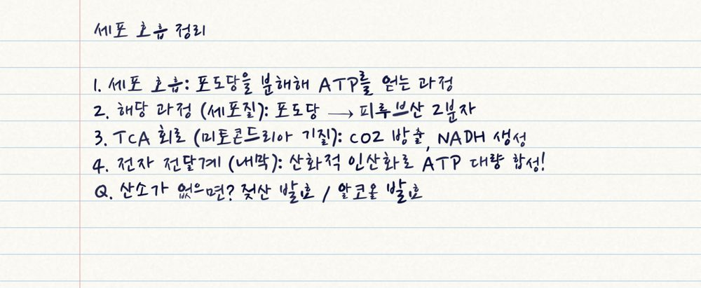

# 손글씨 노트

PDF나 글을 넣으면 **내 손글씨로 쓴 노트 필기 PDF**로 바꿔 주는 프로그램입니다. 모든 처리는 내 컴퓨터
안에서 합니다.

- **PDF – 원래 배치 그대로**: 수식·분수·괄호·상자까지 인쇄본과 같은 자리에 손으로 씁니다 (쪽 범위 지정 가능)
- **PDF – 글만 다시 쓰기 / 글 입력**: 글을 노트 줄(모눈·줄·무지)에 이어서 씁니다
- 같은 글자도 매번 조금씩 다르게, 펜 굵기·글자 간격·기울기는 내 노트 필기에 맞춰 씁니다



> 위 예시는 실제 손글씨 대신 `samples/`의 데모 사진(나눔손글씨 펜 글꼴, SIL OFL로 만든 가짜 손글씨)으로 만든 결과입니다.

## Windows 앱으로 쓰기

1. [HandNote-win.zip 내려받기](https://github.com/Howardjoo09/data/releases/download/handnote/HandNote-win.zip)
   → 압축을 한 번 풀고, 폴더 안의 `HandNote.exe`를 실행합니다 (바탕화면에 바로 가기를 만들어 두면 편합니다).
   파일 하나짜리 [HandNote.exe](https://github.com/Howardjoo09/data/releases/download/handnote/HandNote.exe)도
   있지만, 켤 때마다 160MB를 임시 폴더에 풀기 때문에 시작이 느립니다.
   Python 설치는 필요 없습니다. 서명되지 않은 프로그램이라 처음에 "Windows의 PC 보호" 창이 뜨면
   **추가 정보 → 실행**을 누르세요.
2. 더블클릭하면 작은 창이 뜨고 브라우저에 변환 화면이 열립니다. 작은 창을 닫으면 끝납니다.
3. **글씨체 추가하기**에 채운 템플릿·필사 시트(PDF·사진)를 올리면 그 글씨를 학습하고, 글씨체 파일(`.zip`)을 올리면
   그대로 추가합니다. 여러 사람의 글씨체를 이름을 붙여 두고, 변환할 때 누구 글씨로 쓸지 고릅니다.
   이미 있는 글씨체에 템플릿을 더 올려 글자를 늘릴 수도 있습니다.
4. PDF를 끌어 놓거나 글을 입력하고 **손글씨 노트로 변환**을 누릅니다. 진행률이 보이고, 끝나면
   **PDF 열기 / 저장**을 누르면 됩니다. 결과는 `문서\손글씨노트` 폴더에도 자동으로 저장됩니다.

**글씨체 파일(.zip)** 은 학습한 글씨체 하나를 담은 파일입니다: 글자 한 벌마다 한 장씩인 글자 그림(`g0000.png` …)과,
각 그림이 어떤 글자인지·크기와 위치·펜 굵기와 간격·기울기 보정값·이름을 적은 `profile.json`. 목록의 **내보내기**로
만들고, 다른 사람의 앱에서 **글씨체 추가하기**로 올리면 같은 글씨체를 씁니다.

PDF는 여러 쪽을 CPU 코어 수만큼 동시에 씁니다. 4코어 컴퓨터에서 한 쪽에 약 1초 (미적분 노트 58쪽 전체 약 1분). 글씨체 파일은 내 손글씨 이미지이므로 저장소에
올리지 않고 따로 보관합니다 — 앱의 **글씨체 파일 내보내기**로 언제든 다시 받을 수 있습니다.
앱의 데이터는 `%LOCALAPPDATA%\HandNote`에 있습니다.

exe는 GitHub Actions(`.github/workflows/handnote-app.yml`)가 Windows에서 만들고, 만든 exe를 직접 실행해
자체 시험(견본 글씨 학습 → 글·PDF 변환 → 글씨체 파일 내보내기/불러오기)을 통과해야 올립니다.

## 소스로 실행

```bash
pip install -r requirements.txt
python desktop.py          # 앱 창 + 브라우저 (python desktop.py --self-test 로 자체 시험)
python server.py           # 서버만, http://127.0.0.1:5000
```

Windows에서는 `start.bat`, macOS/Linux에서는 `./start.sh`도 됩니다.

## 내 글씨체 만들기 (`/advanced`)

많이 쓸수록 내 글씨와 더 닮습니다 — 직접 쓴 글자는 그대로 쓰고, 쓰지 않은 한글은 내 글씨의 자모로 조합합니다.
대략적인 작성 시간 (템플릿 한 칸 5~6초, 필사는 평소 필기 속도):

| 방법 | 분량 | 시간 | 미적분 노트에서 직접 쓴 글씨로 쓰는 비율 |
|---|---|---|---|
| 간단 템플릿 | 1쪽 (110칸) | 약 10분 | 81% |
| 간단 템플릿 | 2쪽 (220칸) | 약 20분 | 95% |
| 간단 템플릿 | 3쪽 (330칸) | 약 30분 | 99% |
| 자세히 (문서의 모든 글자) | 7~8쪽 | 1시간 남짓 | 100% |
| 필사 시트 (선택, 실제 노트와 가장 닮음) | 14쪽 | 한 쪽 약 10분 | — |

- **템플릿**: 칸마다 글자를 써서 찍거나 스캔해 올립니다 (`templates/100002.json` 미적분 노트용 등).
- **필사 시트** (`templates/100003.json`, 14쪽): 회색 글을 아래 모눈에 평소 노트처럼 옮겨 씁니다. 문장 속에서 쓴
  글자는 칸 속 글자보다 실제 노트와 닮아서, 2개 이상 있으면 그것만 씁니다. 1쪽은 평가용입니다 —
  학습하지 않고 `tools/tune_profile.py`가 이것과 프로그램의 글씨를 비교해 일치도를 냅니다.
- **자유롭게 쓴 손글씨**: 사진 + 사진에 적힌 내용
- 만든 글씨체는 **이 글씨체를 앱의 '내 글씨체'로 쓰기**를 누르면 첫 화면에서 씁니다.

`/quick`은 글씨체 사진을 매번 올려서 한 번에 변환하는 예전 화면입니다.

## 작동 방식

| 단계 | 하는 일 |
|---|---|
| 템플릿 (`hwnote/template.py`) | 네 모서리에 ArUco 표식, 위쪽에 템플릿 ID·쪽 번호를 담은 검은 사각형 코드(체크섬 포함)를 넣은 A4 PDF를 만듭니다. 칸 안 점선은 영문·숫자의 바닥선입니다. |
| 자유 양식 학습 (`hwnote/freeform.py`) | 손글씨 사진의 기울기를 바로잡고 줄노트 선을 지운 뒤, 줄 간격을 자동으로 재서 줄을 나눕니다(키 큰 글자가 윗줄에 닿아도 분리). 줄마다 잉크 조각을 나누고, 입력한 내용과 **동적 계획법**으로 맞춰 어느 조각들이 어떤 글자인지 정합니다(글자 폭·띄어쓰기 간격 이용). 입력 내용과 사진이 다른 곳(오타·빠진 글자)이 있는 단어는 잘못 배우지 않도록 통째로 건너뜁니다. |
| 글자 추출 (`hwnote/extract.py`) | 사진에서 표식 4개를 찾아 원근을 펴고(뒤집힌 사진도 가능), 조명 얼룩을 보정한 뒤 칸마다 잉크만 잘라 투명 마스크로 저장합니다. 칸 테두리·점선·먼지는 걸러 냅니다. 칸 안에서의 위치(바닥선 기준)와 펜 색도 기록합니다. |
| 한글 조합 (`hwnote/compose.py`) | 직접 쓰지 않은 한글은 내 자모로 만듭니다. 먼저 내가 쓴 글자에서 자모를 떼어 냅니다(예: '각' → 초성 ㄱ·중성 ㅏ·종성 ㄱ과 각각의 위치). 같은 모양의 글자를 만들 때는 그 자모를 원래 쓰던 자리에 그대로 놓아 자연스럽습니다. 획이 이어져 나누기 애매한 글자는 쓰지 않습니다. 템플릿의 자모 칸, 쌍자음·겹받침 조합도 함께 씁니다. |
| 노트 작성 (`hwnote/render.py`) | 글자마다 크기·기울기·위치를 조금씩 흔들고 모양을 미세하게 일그러뜨립니다. 같은 글자를 여러 번 썼다면 번갈아 씁니다. 줄마다 기울기와 물결을 주고, 단어 단위로 줄을 바꿔 줄노트 위에 씁니다. |
| 문서 읽기 (`hwnote/textio.py`) | PDF에서 글을 꺼내 PDF의 자동 줄바꿈은 합치고 문단은 유지합니다. TXT는 UTF-8과 CP949(윈도우 메모장)를 모두 읽습니다. |

학습한 글씨에도, 자모에도 없는 글자(한자 등)는 기본 글꼴을 내 펜 굵기에 맞춰 대신 쓰고,
어떤 글자가 그렇게 쓰였는지 화면에 알려 줍니다. 그 글자들을 템플릿 ①에 넣어 추가 학습하면 됩니다
('현재 글씨체에 글자 추가' 체크).

## 한계와 다음 단계

- 자유 양식은 **사진에 적힌 내용을 입력해야** 합니다(글자 인식 OCR 없음). 내용이 사진과 다르면 그 부근 글자는 건너뜁니다.
  글자가 서로 겹치거나 이어 쓴(흘림) 글씨는 나누기 어렵습니다. 반듯하게 위에서 찍은 사진이 좋습니다(원근 보정은 템플릿만).
- 자유 양식 샘플에 없는 자모(예: ㅛ가 들어간 글자를 하나도 안 썼다면)가 필요한 글자는 기본 글꼴로 씁니다.
  화면에 그런 글자 목록이 나오니, 그 글자들이 들어간 손글씨를 더 올리면 됩니다.
- 자모 조합 한글은 직접 쓴 글자보다 덜 자연스럽습니다. 특히 겹받침 글자(읽, 밟, 쌓)는 작아 보입니다.
  자주 쓰는 글자를 템플릿에 많이 넣을수록 좋아집니다. 더 나아가려면 소수 샘플로 한글 글꼴을 생성하는
  딥러닝 모델(예: MX-Font, DG-Font 계열)을 붙이는 방법이 있습니다.
- 글자 이어 쓰기(필기체 연결)는 하지 않습니다. 한글·정자체 영어에 적합합니다.
- 스캔한 이미지 PDF는 글자를 꺼낼 수 없습니다(OCR 미지원). 글자를 복사할 수 있는 PDF만 됩니다.
- 연필이나 아주 연한 펜은 잘 인식되지 않을 수 있습니다. 진한 검정·파랑 펜을 권장합니다.
- 템플릿 정보·글씨체·결과물은 서버의 `data/` 폴더에 저장됩니다. 로그인·사용자 구분이 없는 개발용 서버이므로
  인터넷에 그대로 공개하지 마세요. 결과물은 24시간 뒤 지워집니다.

## 검증

```bash
python -m unittest discover -s tests -v
```

템플릿 생성 → 글꼴로 채운 가짜 '휴대폰 사진'(원근 왜곡·조명 얼룩·노이즈·JPEG·180° 회전) →
글자 추출 → 노트 작성 → PDF까지 전 과정을 자동으로 확인합니다. 자유 양식은 글자마다 실제 위치를 아는
가짜 손글씨 사진(줄노트·기울기)으로 **각 글자를 올바른 자리에서 잘라 냈는지** 검사합니다(빽빽한 줄, 입력 오타 포함).
페이지 코드 체크섬, 한글 전 범위 조합, 자모 떼어 내기, PDF 문단 복원, CP949 TXT, 웹 API(경로 조작 차단 포함)도 검사합니다.

데모 사진을 다시 만들거나 다른 글꼴로 시험하려면:

```bash
python tools/make_sample.py --font 손글씨글꼴.ttf --out samples --skip 0 --bundle
```

## 폴더 구조

```
desktop.py           Windows 앱 시작 프로그램 (작은 창 + 브라우저, --self-test)
server.py            Flask 서버 (API + 화면): 내 글씨체, 변환 작업(진행률), 템플릿·학습
static/app.html      첫 화면: 내 글씨체 + PDF/글 → 손글씨 노트
static/advanced.html 고급 화면: 템플릿·필사 시트, 글씨체 학습·추가, 글자 고르기
static/convert.html  /quick: 글씨체 사진을 매번 올려 한 번에 변환
hwnote/              엔진: charsets, template, extract, freeform, copysheet, compose, render,
                     pdfnotes(배치 보존 PDF), mathfont, style(측정·보정), score(일치도), textio
tools/               make_sample(테스트용 가짜 손글씨), official_templates, copy_text(필사 시트 글),
                     tune_profile(보정 + 일치도)
templates/           공식 템플릿 (100001 시험용, 100002 미적분, 100003 필사 시트)
samples/             데모 자료 (가짜 손글씨)
tests/               자동 테스트
```
