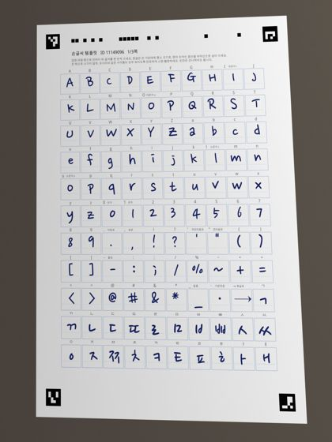

# 손글씨 노트 변환기 (프로토타입)

글(PDF·TXT 파일 또는 직접 입력)을 **내 손글씨로 쓴 노트 필기 PDF**로 바꿔 주는 웹사이트입니다.
내 글씨체는 두 가지 중 편한 방법으로 학습합니다.

- **자유롭게 쓴 손글씨** — 노트·편지 등 평소 글씨 사진 + 그 사진에 적힌 내용(텍스트)
- **템플릿** — 인쇄용 템플릿 칸에 글자를 써서 찍은 사진 (가장 정확)


> 위 예시는 실제 손글씨 대신 `samples/`의 데모 사진(나눔손글씨 펜 글꼴, SIL OFL로 만든 가짜 손글씨)으로 만든 결과입니다.

## 실행

- **Windows**: `start.bat` 더블클릭 (Python 3.10 이상 필요, 처음 한 번은 라이브러리 설치에 1~2분 걸립니다)
- **macOS / Linux**: `./start.sh`

브라우저가 자동으로 `http://127.0.0.1:5000` 을 엽니다. 직접 실행하려면:

```bash
pip install -r requirements.txt
python server.py
```

## 사용법 (메인 페이지)

한 페이지에서 바로 변환합니다.

1. **변환할 PDF** — PDF(또는 TXT)를 고르면 글을 꺼내 보여 줍니다. 고치거나 직접 입력해도 됩니다.
2. **내 글씨체 파일** — 템플릿 사진이면 그대로, 자유롭게 쓴 손글씨면 사진 속 글을 그대로 입력합니다.
   여러 장이면 올린 순서대로 이어서 입력하고, 줄바꿈 위치는 달라도 됩니다. 어떤 종류인지는 자동으로 판별합니다.
3. **변환하기** → 미리보기·PDF 다운로드. 학습한 글씨체는 기억되므로 다음에는 파일 없이 다시 쓸 수 있습니다.

**바로 체험하기:** 페이지 위쪽의 '예시 자료로 채워 보기'를 누르고 변환하기를 누르세요.

## 고급 기능 (`/advanced`)

1. **템플릿 만들기** — 넣을 글자 종류를 고르고 'PDF 만들기' → A4에 실제 크기로 인쇄합니다.
   변환할 글을 미리 붙여 넣으면 그 글에 나오는 모든 글자가 템플릿에 들어가서 결과가 가장 자연스럽습니다.
2. **글씨체 학습** — 칸마다 위에 적힌 글자를 펜으로 쓰고, 사진(또는 스캔 PDF)을 올립니다.
   잘라낸 글자 목록이 바로 보이니 잘못 잘린 칸이 없는지 확인하세요. 글씨체 ID는 브라우저에 기억됩니다.
3. **변환** — 글을 입력하거나 PDF/TXT를 불러온 뒤 종이(줄노트·모눈·무지), 펜 색, 글자 크기, 자간,
   흔들림 정도를 정하고 '손글씨 노트 만들기' → 미리보기와 PDF 다운로드.

템플릿 방식 체험: 메인 페이지의 글씨체 파일에 `samples/demo_page1.jpg ~ demo_page3.jpg` 세 장을 올리면 됩니다.



## 작동 방식

| 단계 | 하는 일 |
|---|---|
| 템플릿 (`hwnote/template.py`) | 네 모서리에 ArUco 표식, 위쪽에 템플릿 ID·쪽 번호를 담은 검은 사각형 코드(체크섬 포함)를 넣은 A4 PDF를 만듭니다. 칸 안 점선은 영문·숫자의 바닥선입니다. |
| 자유 양식 학습 (`hwnote/freeform.py`) | 손글씨 사진의 기울기를 바로잡고 줄노트 선을 지운 뒤, 줄 간격을 자동으로 재서 줄을 나눕니다(키 큰 글자가 윗줄에 닿아도 분리). 줄마다 잉크 조각을 나누고, 입력한 내용과 **동적 계획법**으로 맞춰 어느 조각들이 어떤 글자인지 정합니다(글자 폭·띄어쓰기 간격 이용). 입력 내용과 사진이 다른 곳(오타·빠진 글자)이 있는 단어는 잘못 배우지 않도록 통째로 건너뜁니다. |
| 글자 추출 (`hwnote/extract.py`) | 사진에서 표식 4개를 찾아 원근을 펴고(뒤집힌 사진도 가능), 조명 얼룩을 보정한 뒤 칸마다 잉크만 잘라 투명 마스크로 저장합니다. 칸 테두리·점선·먼지는 걸러 냅니다. 칸 안에서의 위치(바닥선 기준)와 펜 색도 기록합니다. |
| 한글 조합 (`hwnote/compose.py`) | 직접 쓰지 않은 한글은 내 자모로 만듭니다. 먼저 내가 쓴 글자에서 자모를 떼어 냅니다(예: '각' → 초성 ㄱ·중성 ㅏ·종성 ㄱ과 각각의 위치). 같은 모양의 글자를 만들 때는 그 자모를 원래 쓰던 자리에 그대로 놓아 자연스럽습니다. 획이 이어져 나누기 애매한 글자는 쓰지 않습니다. 템플릿의 자모 칸, 쌍자음·겹받침 조합도 함께 씁니다. |
| 노트 작성 (`hwnote/render.py`) | 글자마다 크기·기울기·위치를 조금씩 흔들고 모양을 미세하게 일그러뜨립니다. 같은 글자를 여러 번 썼다면 번갈아 씁니다. 줄마다 기울기와 물결을 주고, 단어 단위로 줄을 바꿔 줄노트 위에 씁니다. |
| 문서 읽기 (`hwnote/textio.py`) | PDF에서 글을 꺼내 PDF의 자동 줄바꿈은 합치고 문단은 유지합니다. TXT는 UTF-8과 CP949(윈도우 메모장)를 모두 읽습니다. |

학습한 글씨에도, 자모에도 없는 글자(한자 등)는 기본 글꼴을 내 펜 굵기에 맞춰 대신 쓰고,
어떤 글자가 그렇게 쓰였는지 화면에 알려 줍니다. 그 글자들을 템플릿 ①에 넣어 추가 학습하면 됩니다
('현재 글씨체에 글자 추가' 체크).

## 한계와 다음 단계

- 자유 양식은 **사진에 적힌 내용을 입력해야** 합니다(글자 인식 OCR 없음). 내용이 사진과 다르면 그 부근 글자는 건너뜁니다.
  글자가 서로 겹치거나 이어 쓴(흘림) 글씨는 나누기 어렵습니다. 반듯하게 위에서 찍은 사진이 좋습니다(원근 보정은 템플릿만).
- 자유 양식 샘플에 없는 자모(예: ㅛ가 들어간 글자를 하나도 안 썼다면)가 필요한 글자는 기본 글꼴로 씁니다.
  화면에 그런 글자 목록이 나오니, 그 글자들이 들어간 손글씨를 더 올리면 됩니다.
- 자모 조합 한글은 직접 쓴 글자보다 덜 자연스럽습니다. 특히 겹받침 글자(읽, 밟, 쌓)는 작아 보입니다.
  자주 쓰는 글자를 템플릿에 많이 넣을수록 좋아집니다. 더 나아가려면 소수 샘플로 한글 글꼴을 생성하는
  딥러닝 모델(예: MX-Font, DG-Font 계열)을 붙이는 방법이 있습니다.
- 글자 이어 쓰기(필기체 연결)는 하지 않습니다. 한글·정자체 영어에 적합합니다.
- 스캔한 이미지 PDF는 글자를 꺼낼 수 없습니다(OCR 미지원). 글자를 복사할 수 있는 PDF만 됩니다.
- 연필이나 아주 연한 펜은 잘 인식되지 않을 수 있습니다. 진한 검정·파랑 펜을 권장합니다.
- 템플릿 정보·글씨체·결과물은 서버의 `data/` 폴더에 저장됩니다. 로그인·사용자 구분이 없는 개발용 서버이므로
  인터넷에 그대로 공개하지 마세요. 결과물은 24시간 뒤 지워집니다.

## 검증

```bash
python -m unittest discover -s tests -v
```

템플릿 생성 → 글꼴로 채운 가짜 '휴대폰 사진'(원근 왜곡·조명 얼룩·노이즈·JPEG·180° 회전) →
글자 추출 → 노트 작성 → PDF까지 전 과정을 자동으로 확인합니다. 자유 양식은 글자마다 실제 위치를 아는
가짜 손글씨 사진(줄노트·기울기)으로 **각 글자를 올바른 자리에서 잘라 냈는지** 검사합니다(빽빽한 줄, 입력 오타 포함).
페이지 코드 체크섬, 한글 전 범위 조합, 자모 떼어 내기, PDF 문단 복원, CP949 TXT, 웹 API(경로 조작 차단 포함)도 검사합니다.

데모 사진을 다시 만들거나 다른 글꼴로 시험하려면:

```bash
python tools/make_sample.py --font 손글씨글꼴.ttf --out samples --skip 0 --bundle
```

## 폴더 구조

```
server.py            Flask 웹 서버 (API + 화면)
static/convert.html  메인 화면: PDF + 글씨체 파일 → 변환 (디자인 없는 프로토타입)
static/advanced.html 고급 화면: 템플릿 만들기, 글씨체 학습·추가, 세부 변환
hwnote/              핵심 엔진: charsets, template, extract, freeform, compose, render, textio
tools/make_sample.py 글꼴로 템플릿·자유 양식 손글씨 사진을 만드는 도구 (테스트·데모용)
samples/             데모 자료: 템플릿 사진 3장, 자유 양식 손글씨 사진과 그 내용, 변환 예시 글
tests/               자동 테스트
```
